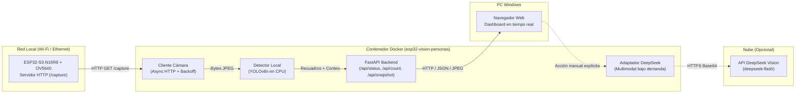

# Arquitectura del Sistema: Conteo de Personas ESP32-S3 + Docker

## 1. Visión General del Sistema

El sistema implementa una arquitectura desacoplada donde el dispositivo embebido (**ESP32-S3**) se encarga de la captura y servicio de imágenes en red local, mientras que la estación anfitriona (**PC Windows**) ejecuta el procesamiento pesado de visión por computadora dentro de un contenedor **Docker** aislado.

---

## 2. Flujo de Datos

1. **Adquisición Periódica:**
   * El servicio de fondo (`camera_worker`) realiza solicitudes `GET /capture` hacia el ESP32-S3 a intervalos regulares configurables (por defecto cada 2.0 s).
   * La respuesta se valida mediante los bytes de encabezado y final (`0xFFD8` / `0xFFD9`) antes de pasar a la memoria.

2. **Procesamiento de Inferencia Local (CPU):**
   * El fotograma JPEG se entrega a `PersonDetector`, el cual ejecuta el modelo YOLOv8n restringido a la clase COCO `0` (`person`).
   * No se satura el bucle asíncrono de FastAPI: el cómputo de inferencia se delega a un hilo de ejecución independiente (`asyncio.to_thread`).
   * Las coordenadas de las personas detectadas se renderizan en una imagen anotada temporal y se conservan únicamente en la memoria RAM del servidor.

3. **Consumo y Visualización:**
   * El cliente web consulta la telemetría en `/api/status` y refresca el visor de imagen en `/api/snapshot`.
   * El conteo visible se muestra en un indicador visual de alta prominencia.

---

## 3. Especificación de la API HTTP

| Método | Endpoint | Parámetros | Descripción |
|---|---|---|---|
| `GET` | `/` | Ninguno | Panel web interactivo |
| `GET` | `/health` | Ninguno | Verificación de salud interna del contenedor |
| `GET` | `/api/status` | Ninguno | Telemetría detallada de cámara, detector, conteo y DeepSeek |
| `GET` | `/api/count` | Ninguno | Consulta compacta del número de personas en el último cuadro |
| `GET` | `/api/snapshot` | `raw=false` (anotada), `raw=true` (limpia) | Fotograma JPEG más reciente |
| `POST` | `/api/analyze/deepseek` | JSON opcional `{"prompt": "..."}` | Solicitud explícita de análisis multimodal en la nube |

---

## 4. Seguridad, Aislamiento y Privacidad

1. **Sin persistencia de fotografías:** Las imágenes solo residen en el búfer de memoria volátil del proceso; no se guardan archivos `.jpg` en disco ni en bases de datos.
2. **Sin reconocimiento biométrico:** El modelo YOLO detecta la geometría y características generales del cuerpo humano (`person`); no se extraen mapas de rasgos faciales ni identidades.
3. **Conteo instantáneo vs. Conteo acumulado:** El conteo representa el número de personas simultáneas presentes en el fotograma analizado. No debe confundirse con un sensor de torniquete o conteo acumulativo de entradas/salidas.
4. **Frontera de Red y DeepSeek:**
   * Toda la comunicación entre el ESP32 y el servidor Docker transcurre **exclusivamente dentro de la red de área local (LAN)**.
   * Ningún fotograma sale a internet a menos que el usuario presione intencionalmente el botón *"Consultar DeepSeek"*.
